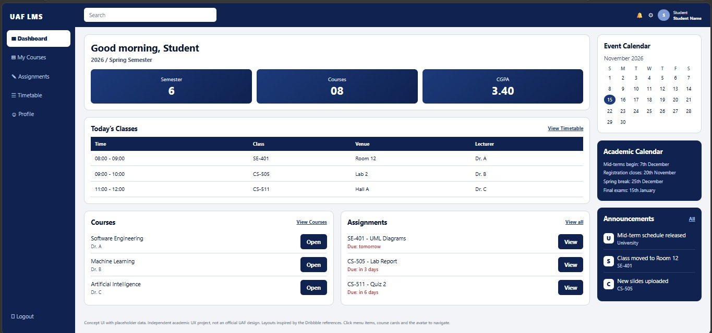
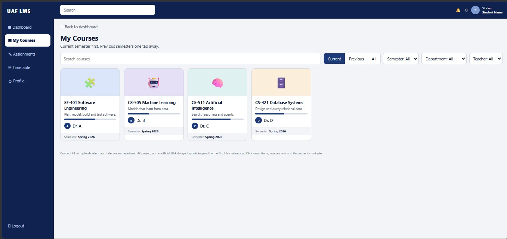
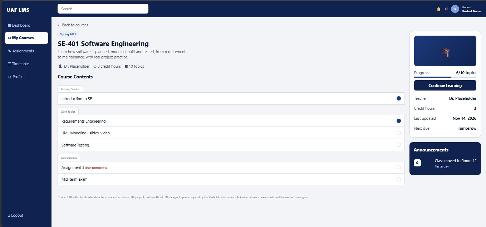
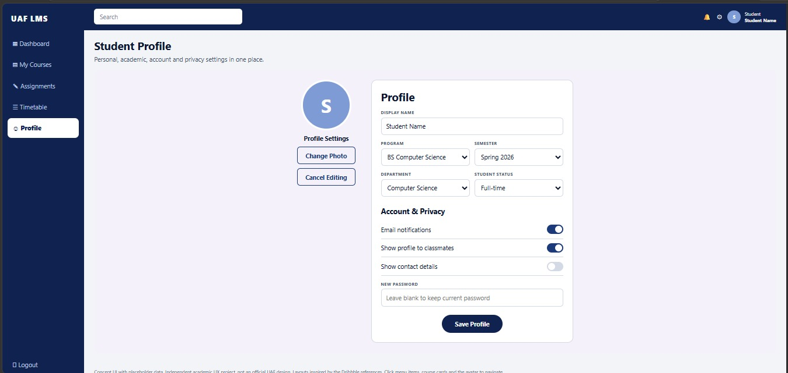

# UAF LMS - Usability Evaluation & UX Redesign

A Human-Computer Interaction (HCI) project that evaluates the existing University of Agriculture Faisalabad (UAF) Learning Management System and proposes a clearer, more user-friendly student interface.

**Existing system:** https://lms.uaf.edu.pk/
**Figma prototype:** [View Prototype](https://www.figma.com/design/N0ByaDQ1xhNTZrrjY6UotD/UAF-LMS---UX-Redesign?node-id=1-3&t=l8grymIqyYdTnSPt-1)

## Objectives
- Evaluate the existing LMS interface
- Identify navigation and usability problems
- Apply HCI and usability principles
- Design improved screens and an interactive Figma prototype

## Key Findings
- Overloaded navigation sidebar
- Long course lists across semesters
- Confusing "Courses" vs "My Courses"
- Unclear topic organization
- Reported navigation delay with unclear feedback
- Limited progress visibility
- Poor visual hierarchy
- Overloaded profile page and a legacy ICQ field

Full list: [`research/usability-findings.md`](research/usability-findings.md)

## HCI Principles Applied
Based on Nielsen's usability heuristics:
- **Visibility of system status:** clear loading and progress feedback
- **Consistency and standards:** one clear naming for course sections
- **Recognition over recall:** simpler navigation, fewer hidden options
- **Aesthetic and minimalist design:** reduced clutter, stronger visual hierarchy

## Proposed Redesign
Four screens in a navy-blue, white and light-grey design system.

### Student Dashboard

### My Courses

### Course Details

### Student Profile

## Repository Structure
- `research/` - project overview, usability evaluation, findings, HCI principles
- `screenshots/` - existing LMS interface evidence (personal information redacted)
- `wireframes/` - redesigned screens (exports from Figma)
- `ui-design/` - UI design exports
- `prototype/` - Figma prototype link

## Status
Week 1 done: HCI introduction, existing interface evaluation, prototyping environment setup. Work in progress, updated weekly.

## Author
**Minahil**
BS Computer Science, University of Agriculture Faisalabad (UAF)
Course: Human-Computer Interaction (HCI) | Semester: 7

## Disclaimer
This is an independent academic UX concept. It is not an official UAF project and does not modify the actual university LMS.
